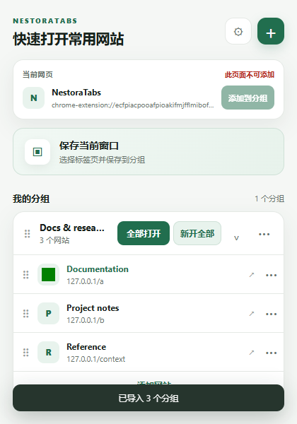
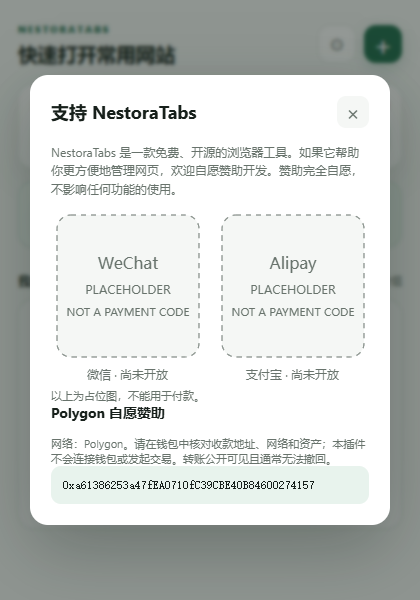

# NestoraTabs

A lightweight, privacy-friendly Chrome extension for organizing, saving, and opening tabs and bookmarks.

[English](README_EN.md) · [下载预发布测试版](https://github.com/dayanyanli/NestoraTabs/releases) · [隐私说明](PRIVACY.md)

**永久免费，自愿打赏不影响任何功能。** 主要支持 Chrome 及兼容的 Chromium 浏览器。原本地开发名称为 TabNest，现更名为 NestoraTabs，与其他同名产品无关联。

> **v1.0.1 预发布测试版：** 原有应用代码的来源记录尚未完全核实，随附 MIT 声明不构成对全部权利的独立证明；新图标已重新绘制并记录来源。主要功能已通过实际 Chromium 测试，原生右键菜单点击、Chrome 工具栏弹窗、物理拖拽和原地升级仍待手工验证。维护者已明确授权在披露这些风险的前提下公开测试版。请自行评估后安装，尚不视为正式稳定版。

## 功能

- 一键保存当前网页；选择并保存当前窗口的可用网页
- 网页分类和分组管理；分组与网站排序、复制、折叠
- 右键菜单快速添加；导入 Chrome 收藏夹及子文件夹
- 批量打开分组、防止重复收藏与重复打开；支持强制新建标签页打开
- JSON 导入、合并、替换与导出备份；显示可用 favicon
- chrome.storage.local 本地保存，无需账号或开发者服务器

## 安装（重要）

1. 从 [GitHub Releases](https://github.com/dayanyanli/NestoraTabs/releases) 下载扩展 ZIP；当前请选择明确标注为 **Pre-release** 的 `nestoratabs-v1.0.1-candidate.zip`，未来正式版使用正式 ZIP。
2. 解压 ZIP。
3. 打开 `chrome://extensions`。
4. 启用开发者模式。
5. 点击“加载已解压的扩展程序”。
6. 选择包含 `manifest.json` 的插件目录。

**只有在信任源码与发布者时才应加载第三方扩展。** 更换加载目录会改变扩展 ID 和本地存储空间；原 TabNest 用户应先导出 JSON，再在新插件导入，不会自动迁移另一扩展 ID 的数据。

## 截图

截图来自真实 Chromium 扩展页面，尺寸 420×600；不是 Chrome 工具栏气泡的验证截图。

## 隐私与备份

网页和分组数据保存在浏览器本地，不上传给开发者。无追踪、广告或云同步承诺；请通过 JSON 导出备份。浏览器提供或 JSON 导入的远程 favicon 地址可能联系图片主机，暴露 IP 等正常请求元数据。请勿导入不信任的备份。详见 [PRIVACY.md](PRIVACY.md)。

## 支持开发者

管理配置 → 支持开发者，点击后才显示赞助内容。赞助完全自愿，不影响任何功能的使用。微信和支付宝暂为明确标注的本地占位图，不能付款。Polygon 收款地址由维护者提供，请核对网络、地址和资产；插件不连接钱包、不发起交易、不记录支付信息。未验证收款所有权、资产兼容性或平台批准，区块链交易公开且通常无法撤回。

## 开发、许可与贡献

运行插件无需 npm 依赖或构建。用 Node 分别运行 `tests/core.test.js`、`tests/background.test.js`、`tests/migration.test.js`、`tests/security.test.js`、`tests/popup.test.js`。后者使用模拟 DOM/API；实际浏览器测试脚本为 `tests/browser-regression.cjs`，需另行准备 Playwright Chromium 环境，参见 [测试说明](docs/TESTING.md)。

欢迎 Issues 和 Pull Requests。请阅读 [贡献指南](CONTRIBUTING.md)、[素材授权清单](docs/ASSET_LICENSES.md) 与 [发布审计](RELEASE_AUDIT.md)。保留原 MIT LICENSE 及署名，不以更名重新授权他人内容。`release/` 仅用于经过完整验证的正式包，当前测试包由 GitHub Pre-release 提供。
